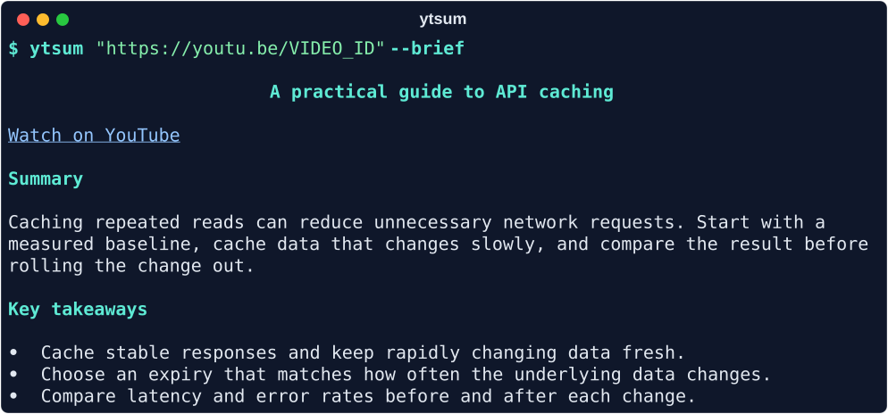

<div align="center">

# ytsum

**A YouTube link in. Useful notes out.**

Summarize video transcripts with a local model, read them in your terminal,
and keep the results as Markdown.

[](https://www.python.org/downloads/)
[](LICENSE)

</div>

```sh
ytsum "https://youtu.be/kCc8FmEb1nY"
```



*Illustrative notes for [Andrej Karpathy's GPT-from-scratch tutorial](https://youtu.be/kCc8FmEb1nY). Actual model output varies.*

## What you get

- **Readable notes:** an overview, key takeaways, useful details, and relevant caveats.
- **Local inference:** Ollama runs on your computer by default. No cloud account or API key is required.
- **Easy exports:** styled output in a terminal; clean Markdown when saved or piped.
- **Quick reruns:** completed summaries are cached, so repeating a request skips inference.
- **Long videos:** processes the transcript in parts when needed, then combines the notes.
- **Flexible input:** full links, short links, Shorts, video IDs, clipboard links, and transcript files.

Captions come from [dudarev/ytt](https://github.com/dudarev/ytt).
This tool does not download audio, transcribe speech, or analyze on-screen visuals.

## Quickstart

### 1. Install the prerequisites

You need [uv](https://docs.astral.sh/uv/getting-started/installation/),
[Git](https://git-scm.com/downloads), and [Ollama](https://ollama.com/download).
uv manages the Python 3.12 environment for the commands below.

On macOS with Homebrew:

```sh
brew install uv ollama
brew services start ollama
```

On Linux or Windows, install the prerequisites using their official instructions.
Start the Ollama app or run `ollama serve` in another terminal before continuing.
End-to-end usage has been tested on Apple Silicon macOS. Linux and Windows have
not been verified end to end.

### 2. Install the transcript tool and ytsum

```sh
uv tool install --python 3.12 git+https://github.com/dudarev/ytt.git
uv tool install --python 3.12 git+https://github.com/lucasscariot/ytsum.git
uv tool update-shell
```

If uv updated your shell configuration, **open a new terminal** before the next step.

Use the linked YouTube version of `ytt`: Homebrew's `ytt` package is an unrelated
YAML templating tool. Remove that package first if it occupies the same command name.

### 3. Configure languages and download a model

```sh
ytt config languages en
ollama pull qwen3.5:9b-q4_K_M
```

The default model download is about **6.6 GB**. Running it also needs memory for
the model and transcript context; download size is not a RAM requirement.
See [choosing a model](#choosing-a-model) for a smaller option.

### 4. Summarize a video

```sh
ytsum "https://youtu.be/kCc8FmEb1nY"
```

The first run fetches captions and generates a summary. Repeating the same
request uses the local caption and summary caches.

## Everyday use

| Want to… | Run |
| --- | --- |
| Get the usual overview and notes | `ytsum "URL"` |
| Read a shorter summary | `ytsum "URL" --brief` |
| Keep more supporting detail | `ytsum "URL" --detailed` |
| Read a link from your clipboard | `ytsum` |
| Save Markdown and display the result | `ytsum "URL" -o notes.md` |
| Display and save raw Markdown | `ytsum "URL" \| tee notes.md` |
| Summarize an existing transcript | `ytsum - < transcript.txt` |
| Refresh captions and regenerate | `ytsum "URL" --refresh` |

Replace `URL` with a YouTube link. Keep links in quotes so your shell handles
characters such as `?` and `&` correctly.

The normal summary targets 200–300 words, with sections for **Summary**,
**Key takeaways**, **Useful details**, **Action items**, and **Caveats**.
Empty sections are omitted; actions are requested only when the source recommends
them. `--brief` targets 120–180 words and includes only the overview and takeaways.
`--detailed` targets 500–700 words. Short sources get shorter summaries.
Summaries are in English.

### Copied links work too

```sh
ytsum kCc8FmEb1nY
ytsum 'https://www.youtube.com/watch\?v\=kCc8FmEb1nY'
ytsum '[Watch this](https://youtu.be/kCc8FmEb1nY)'
```

The same normalization applies to clipboard input. Literal shell escapes,
percent encoding, HTML entities, and surrounding quotes or angle brackets are
handled automatically. Tracking parameters and timestamps are discarded once
the video is identified. URL text is never executed as shell code.

### Files and pipes

```sh
ytsum "https://youtu.be/kCc8FmEb1nY" --detailed -o notes/video.md
ytsum "https://youtu.be/kCc8FmEb1nY" > summary.md
cat transcript.txt | ytsum - --brief
```

`-o` creates parent directories and replaces an existing file after a successful
summary. Errors do not overwrite the requested destination. Progress and timing
go to stderr; stdout contains the summary. The clipboard is never overwritten.

## Choosing a model

| Model | Download | Suggested use |
| --- | --- | --- |
| `qwen3.5:9b-q4_K_M` | ~6.6 GB | Default; a balance of speed and fidelity |
| `qwen3.5:4b-q4_K_M` | ~3.3 GB | Faster, with a greater chance of missing or misstating details |

These are [Ollama model tags](https://ollama.com/library/qwen3.5/tags).
The explicit `q4_K_M` variants support constrained JSON output. Thinking is disabled
to reduce latency, and models stay loaded for up to ten minutes between requests.

```sh
ollama pull qwen3.5:4b-q4_K_M
ytsum "https://youtu.be/kCc8FmEb1nY" --model qwen3.5:4b-q4_K_M
```

Set `YTSUM_MODEL` in your shell to change the default:

```sh
export YTSUM_MODEL=qwen3.5:4b-q4_K_M
```

Other installed Ollama models must follow the requested JSON structure and support
disabling thinking. Backends without constrained output fall back to JSON
instructions, with validation before anything is rendered or saved.

## Options and configuration

Run `ytsum --help` for the complete interface.

| Option | Effect |
| --- | --- |
| `--model MODEL` | Select an installed Ollama model |
| `-o FILE`, `--output FILE` | Also save the summary as Markdown |
| `--markdown` | Print raw Markdown even in a terminal |
| `--refresh` | Refresh captions and regenerate the summary |
| `--no-cache` | Bypass the summary cache; caption caching still applies |
| `-q`, `--quiet` | Hide progress and timing |
| `--version` | Show the installed version |

| Environment variable | Default | Purpose |
| --- | --- | --- |
| `YTSUM_MODEL` | `qwen3.5:9b-q4_K_M` | Default model |
| `OLLAMA_HOST` | `http://127.0.0.1:11434` | Ollama server address |
| `XDG_CACHE_HOME` | `~/.cache` | Parent directory for the `ytsum/` summary cache |

Caption language preferences belong to `ytt`. For example,
`ytt config languages en,fr` tries English before French.

## How it works

```text
YouTube link → ytt captions → local Ollama model → validated summary → Markdown
```

Fetching captions requires internet access. With the default localhost server
and a local model, inference runs on your computer. A remote `OLLAMA_HOST` sends
the transcript to that server instead.

Summary caches are keyed by transcript, model name, style, and prompt version.
Changing any of those creates a new entry. If you update weights behind the same
model tag, use `--refresh` to regenerate old summaries. Caption caches are managed
separately by `ytt`.

Long transcripts are split without discarding text, summarized in order, and
combined. Each request has an explicit context allocation up to 65,536 tokens.
Longer videos need more model calls, and compression can omit details. Captions
and local models can misstate facts; check the source when exact wording or
numbers matter.

## Troubleshooting

| Problem | What to try |
| --- | --- |
| `ytsum` or `ytt` is not found | Run `uv tool update-shell`, then open a new terminal |
| `ytt` shows YAML templating options | Install [dudarev/ytt](https://github.com/dudarev/ytt) using the quickstart |
| Caption languages are not configured | Run `ytt config languages en` |
| Ollama cannot be reached | Open Ollama, run `ollama serve`, or use `brew services start ollama` on macOS |
| Model is unavailable | Run `ollama pull qwen3.5:9b-q4_K_M`, or pull your selected model |
| Captions cannot be fetched | Try `ytt fetch "URL" --no-copy`; captions may be unavailable or YouTube may be blocking requests |
| Clipboard cannot be read | Pass the link directly; Linux may require an additional clipboard backend |
| Output looks like an old result | Use `--refresh` |
| Generation is slow | Try the 4B model and `--brief`; long transcripts and the first load take longer |
| Model output is invalid or truncated | Try `--brief`, `--refresh`, or another supported model |

## Update or uninstall

```sh
uv tool install --reinstall --python 3.12 git+https://github.com/lucasscariot/ytsum.git
uv tool uninstall ytsum
```

Uninstalling keeps downloaded Ollama models and local caches.

## Development

```sh
git clone https://github.com/lucasscariot/ytsum.git
cd ytsum
uv sync --locked
uv run ruff check .
uv run ruff format --check .
uv run python -m unittest discover -s tests -v
uv build --no-sources
```

Automated tests use mocked captions and model responses; they do not need Ollama,
YouTube access, or model downloads. To smoke-test the built package in an isolated
environment, run `uvx --from ./dist/ytsum-0.1.2-py3-none-any.whl ytsum --help`.
Use `uv tool install --reinstall .` after editing the source to update your
installed command.

Bug reports and improvements are welcome through [issues](https://github.com/lucasscariot/ytsum/issues)
and pull requests. Include your OS, `ytsum --version`, the command, and the error
message so the problem can be reproduced.

## Credits and license

Built with [ytt](https://github.com/dudarev/ytt), [Ollama](https://ollama.com/),
[Rich](https://github.com/Textualize/rich), and [pyperclip](https://github.com/asweigart/pyperclip).

[MIT License](LICENSE) · Copyright © 2026 Lucas
